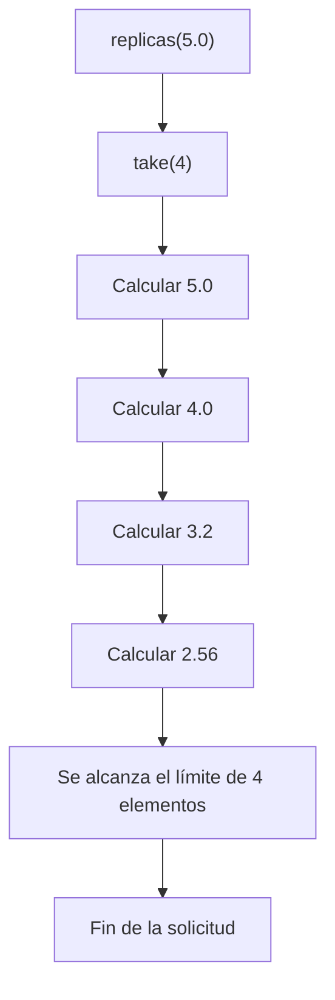

# Informe de Proceso

## 1. Introducción

En este taller se desarrollan funciones en Scala para realizar consultas y procesar información de un registro sísmico. Se utilizan herramientas de programación funcional como expresiones `for`, listas, mapas, opciones y secuencias perezosas.

El objetivo de este informe es explicar el funcionamiento de cada función, las operaciones que realiza internamente y el procedimiento mediante el cual obtiene sus resultados.

---

## 2. Punto 1: Consultas con expresiones `for`

### 2.1. Función `fuertes`

**Definición del algoritmo**

Esta función obtiene las regiones de los sismos cuya magnitud supera un umbral determinado.

```scala
def fuertes(r: Registro, umbral: Double): List[String] = {
  for {
    sismo <- r
    if sismo.magnitud > umbral
  } yield sismo.region
}
```

**Explicación paso a paso**

1. La función recibe un registro de sismos y un umbral de magnitud.
2. Recorre cada sismo del registro mediante el generador `sismo <- r`.
3. Comprueba si la magnitud del sismo es mayor que el umbral.
4. Si cumple la condición, obtiene el nombre de su región.
5. Finalmente, devuelve una lista con las regiones seleccionadas.

La expresión `for` se traduce en las operaciones `withFilter` y `map`.

- `withFilter` selecciona los sismos que superan el umbral.
- `map` transforma cada sismo seleccionado en su región.

La función conserva el orden original del registro y también conserva las regiones repetidas.

### 2.2. Función `enRegion`

**Definición del algoritmo**

Esta función obtiene las magnitudes de los sismos pertenecientes a una región específica.

```scala
def enRegion(r: Registro, region: String): List[Double] = {
  for {
    sismo <- r
    if sismo.region == region
  } yield sismo.magnitud
}
```

**Explicación paso a paso**

1. Recibe el registro y el nombre de la región que se desea consultar.
2. Recorre todos los sismos.
3. Compara la región de cada sismo con la región solicitada.
4. Selecciona únicamente los sismos que coinciden.
5. Obtiene la magnitud de cada sismo seleccionado.
6. Devuelve una lista con las magnitudes encontradas.

La expresión `for` utiliza `withFilter` para aplicar la condición y `map` para obtener las magnitudes.

### 2.3. Función `paresCercanos`

**Definición del algoritmo**

Esta función encuentra parejas de regiones diferentes que tienen al menos dos sismos cuyas magnitudes presentan una diferencia menor o igual al límite establecido.

**Explicación paso a paso**

1. Recorre el registro y obtiene las regiones de los sismos.
2. Utiliza `distinct` para eliminar las regiones repetidas.
3. Genera parejas de regiones diferentes.
4. Utiliza `drop` para evitar generar parejas repetidas en orden inverso.
5. Recorre los sismos pertenecientes a la primera región.
6. Recorre los sismos pertenecientes a la segunda región.
7. Comprueba que cada sismo pertenezca a la región correspondiente.
8. Calcula la diferencia absoluta entre sus magnitudes.
9. Comprueba si la diferencia es menor o igual al valor `dif`.
10. Si se cumple la condición, agrega la pareja de regiones al resultado.
11. Finalmente, utiliza `distinct` para eliminar parejas duplicadas.

Las expresiones `for` se traducen en operaciones como `map`, `flatMap` y `withFilter`.

**Ejemplo**

Si existen sismos de las regiones Norte y Sur con magnitudes 5.0 y 5.3, respectivamente, y el límite es 0.5, la diferencia es:

\[
|5.0-5.3|=0.3
\]

Como 0.3 es menor o igual a 0.5, la pareja `(Norte, Sur)` se incluye en el resultado.

---

## 3. Punto 2: Agrupamiento con mapas

### 3.1. Función `porRegion`

**Definición del algoritmo**

Esta función agrupa todos los sismos según la región a la que pertenecen.

```scala
def porRegion(r: Registro): Map[String, List[Sismo]] = {
  r.groupBy(_.region)
}
```

**Explicación paso a paso**

1. Recibe el registro de sismos.
2. Recorre los elementos del registro.
3. Obtiene la región de cada sismo.
4. Agrupa los sismos que tienen la misma región.
5. Construye un mapa donde cada clave representa una región y su valor contiene la lista de sismos correspondientes.

La operación `groupBy` permite organizar los elementos de una colección utilizando un criterio de agrupamiento.

### 3.2. Función `conteoPorRegion`

**Definición del algoritmo**

Esta función calcula la cantidad de sismos registrados en cada región.

```scala
def conteoPorRegion(r: Registro): Map[String, Int] = {
  porRegion(r).map {
    case (region, sismos) => (region, sismos.length)
  }
}
```

**Explicación paso a paso**

1. Llama a `porRegion` para agrupar los sismos.
2. Recorre las entradas del mapa.
3. Obtiene el nombre de la región y su lista de sismos.
4. Utiliza `length` para contar los elementos de cada lista.
5. Construye un nuevo mapa con la región y la cantidad de sismos.

La operación `map` transforma cada entrada del mapa en una nueva pareja formada por la región y su cantidad.

### 3.3. Función `magnitudMaxima`

**Definición del algoritmo**

Esta función obtiene la magnitud más alta registrada en cada región.

```scala
def magnitudMaxima(r: Registro): Map[String, Double] = {
  porRegion(r).map {
    case (region, sismos) =>
      (region, sismos.map(_.magnitud).max)
  }
}
```

**Explicación paso a paso**

1. Agrupa los sismos mediante `porRegion`.
2. Recorre cada región y su lista de sismos.
3. Utiliza `map` para obtener únicamente las magnitudes.
4. Aplica `max` para encontrar la magnitud más alta.
5. Construye un mapa con cada región y su magnitud máxima.

---

## 4. Punto 3: Consultas seguras

### 4.1. Función `conteoSeguro`

**Definición del algoritmo**

Esta función devuelve un mapa que permite consultar la cantidad de sismos registrados en cada región. Si se consulta una región que no existe, devuelve cero.

**Explicación paso a paso**

1. Recibe el registro de sismos.
2. Agrupa los sismos por región.
3. Calcula la cantidad de elementos de cada grupo.
4. Construye un mapa de conteos.
5. Configura el mapa para que las regiones inexistentes devuelvan cero.

De esta manera, se evita que una consulta sobre una región inexistente produzca un error.

### 4.2. Función `maximaDe`

**Definición del algoritmo**

Esta función obtiene la magnitud máxima de una región determinada o devuelve un resultado vacío cuando no existen sismos registrados en ella.

**Explicación paso a paso**

1. Recibe el registro y el nombre de una región.
2. Recorre los sismos buscando los que pertenecen a esa región.
3. Obtiene sus magnitudes.
4. Comprueba si existen elementos en la lista resultante.
5. Si existen sismos, calcula la magnitud máxima.
6. Devuelve el resultado mediante `Some`.
7. Si no existen sismos, devuelve `None`.

El uso de `Option[Double]` permite representar dos situaciones:

- `Some(magnitud)`: existe una magnitud máxima.
- `None`: no existen registros para la región solicitada.

### 4.3. Función `regionMasActiva`

**Definición del algoritmo**

Esta función identifica la región que tiene la mayor cantidad de sismos registrados. Si varias regiones tienen la misma cantidad, selecciona la primera en orden alfabético.

**Explicación paso a paso**

1. Recibe el registro de sismos.
2. Agrupa los elementos por región.
3. Calcula la cantidad de sismos de cada región.
4. Compara los conteos obtenidos.
5. Identifica la región con mayor cantidad de registros.
6. Si existe un empate, compara los nombres de las regiones alfabéticamente.
7. Devuelve la región seleccionada mediante `Some`.
8. Si el registro está vacío, devuelve `None`.

**Ejemplo**

Supongamos los siguientes conteos:

| Región | Cantidad |
|---|---:|
| Norte | 5 |
| Centro | 8 |
| Sur | 8 |
| Este | 3 |

Las regiones Centro y Sur tienen la misma cantidad de sismos. Por lo tanto, se selecciona Centro porque aparece primero en orden alfabético.

El resultado es:

```scala
Some("Centro")
```

---

## 5. Punto 4: Réplicas perezosas

### 5.1. Función `redondear`

**Definición del algoritmo**

Esta función redondea un número decimal a dos cifras después del punto decimal.

```scala
def redondear(x: Double): Double =
  Math.round(x * 100.0) / 100.0
```

**Explicación paso a paso**

1. Recibe un número decimal.
2. Multiplica el valor por 100.
3. Utiliza `Math.round` para redondear el resultado.
4. Divide nuevamente entre 100.
5. Devuelve el número redondeado a dos decimales.

Por ejemplo:

\[
redondear(3.14159)=3.14
\]

### 5.2. Función `replicas`

**Definición del algoritmo**

Esta función genera una secuencia perezosa infinita que comienza con una magnitud inicial y multiplica cada elemento por 0.8 para obtener el siguiente.

**Explicación paso a paso**

1. Recibe la magnitud inicial.
2. Genera el primer elemento con el valor recibido.
3. Multiplica la magnitud por 0.8 para obtener la siguiente réplica.
4. Continúa aplicando la misma operación a los elementos siguientes.
5. Utiliza `LazyList` para calcular los valores únicamente cuando son solicitados.

**Ejemplo**

Si la magnitud inicial es 5.0, la secuencia comienza así:

| Posición | Operación | Resultado |
|---|---|---:|
| 1 | Magnitud inicial | 5.0 |
| 2 | 5.0 × 0.8 | 4.0 |
| 3 | 4.0 × 0.8 | 3.2 |
| 4 | 3.2 × 0.8 | 2.56 |
| 5 | 2.56 × 0.8 | 2.05 |

La secuencia continúa indefinidamente, pero sus elementos se calculan bajo demanda.

### 5.3. Función `replicasSensibles`

**Definición del algoritmo**

Esta función obtiene las réplicas cuya magnitud supera el mínimo establecido, incluyendo la primera magnitud cuando cumple la condición.

**Explicación paso a paso**

1. Recibe la magnitud inicial y el mínimo permitido.
2. Genera la secuencia de réplicas mediante `replicas`.
3. Recorre los elementos de la secuencia.
4. Comprueba cuáles superan el mínimo establecido.
5. Conserva los valores que cumplen la condición.
6. Convierte el resultado en una lista finita.

La evaluación se detiene cuando los elementos generados dejan de superar el mínimo, evitando recorrer una secuencia infinita innecesariamente.

### 5.4. Traza de evaluación perezosa

Para comprender el funcionamiento, se considera una magnitud inicial de 5.0 y se solicitan los primeros cuatro elementos mediante `take(4)`.

```scala
replicas(5.0).take(4)
```

La evaluación ocurre de la siguiente manera:

| Paso | Elemento solicitado | Valor |
|---|---|---:|
| 1 | Primer elemento | 5.0 |
| 2 | Segundo elemento | 4.0 |
| 3 | Tercer elemento | 3.2 |
| 4 | Cuarto elemento | 2.56 |

Cuando se obtienen los cuatro elementos solicitados, `take(4)` termina.

**Diagrama de ejecución**



Esto demuestra que no es necesario calcular una secuencia infinita completa para obtener una cantidad limitada de elementos.

---

## 6. Punto 5: Informe combinado

### 6.1. Función `informe`

**Definición del algoritmo**

Esta función combina diferentes consultas para construir un resumen de información sísmica por región.

El resultado contiene el conteo de sismos, la magnitud máxima y las réplicas esperadas del sismo más fuerte de cada región.

**Explicación paso a paso**

1. Recibe el registro sísmico y el valor mínimo para considerar una réplica sensible.
2. Agrupa los sismos por región.
3. Recorre cada grupo de sismos.
4. Calcula la cantidad de sismos registrados en cada región.
5. Identifica la magnitud máxima de cada grupo.
6. Determina cuál es el sismo más fuerte de la región.
7. Utiliza la magnitud máxima para generar las réplicas esperadas.
8. Aplica el mínimo establecido para seleccionar las réplicas sensibles.
9. Construye un resumen con los resultados obtenidos.
10. Almacena cada resumen en un mapa utilizando la región como clave.

De esta manera, la función reúne diferentes cálculos en una sola estructura de datos.

### 6.2. Ejemplo de funcionamiento

Supongamos que una región tiene cuatro sismos registrados con las siguientes magnitudes:

\[
[3.0,\ 4.0,\ 5.0,\ 4.5]
\]

El proceso obtiene:

- Conteo de sismos: 4.
- Magnitud máxima: 5.0.
- Magnitud inicial para generar réplicas: 5.0.
- Réplicas: se calculan multiplicando sucesivamente por 0.8.
- Réplicas sensibles: se conservan aquellas que superan el mínimo establecido.

Finalmente, toda esta información se almacena en el resumen correspondiente a esa región.

---

## 7. Operaciones utilizadas en las expresiones `for`

Las expresiones `for` de Scala permiten recorrer colecciones, aplicar condiciones y construir nuevos resultados.

Dependiendo de su estructura, el compilador las traduce en diferentes operaciones:

- `map`: transforma cada elemento de una colección.
- `flatMap`: transforma cada elemento y combina los resultados obtenidos.
- `withFilter`: permite aplicar condiciones antes de continuar el procesamiento.
- `foreach`: ejecuta una operación para cada elemento sin producir una nueva colección.

Por ejemplo:

```scala
for (sismo <- r if sismo.magnitud > 5.0)
  yield sismo.region
```

Se traduce conceptualmente en:

```scala
r.withFilter(sismo => sismo.magnitud > 5.0)
 .map(sismo => sismo.region)
```

En el caso de `paresCercanos`, al existir varios generadores, se utilizan operaciones encadenadas de `flatMap`, `withFilter` y `map`.

Esto permite recorrer diferentes combinaciones de elementos y seleccionar únicamente las parejas que cumplen las condiciones.

---

## 8. Conclusión

Durante el desarrollo del taller se aplicaron diferentes herramientas de programación funcional de Scala para procesar información sísmica.

En el primer punto se utilizaron expresiones `for` para recorrer listas, aplicar condiciones y construir resultados. En el segundo punto se utilizaron mapas para agrupar información y obtener estadísticas por región.

En el tercer punto se implementaron consultas seguras mediante `Option` y valores predeterminados. En el cuarto punto se trabajó con secuencias perezosas mediante `LazyList`, demostrando que los elementos pueden calcularse únicamente cuando son necesarios.

Finalmente, en el quinto punto se combinaron los resultados anteriores para generar un informe completo por región.

Estas operaciones permiten procesar información de manera organizada y funcional, aprovechando las características del lenguaje Scala.